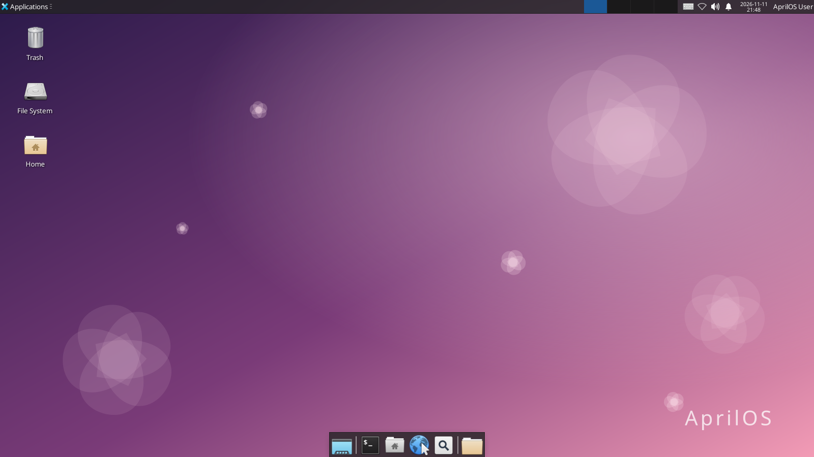
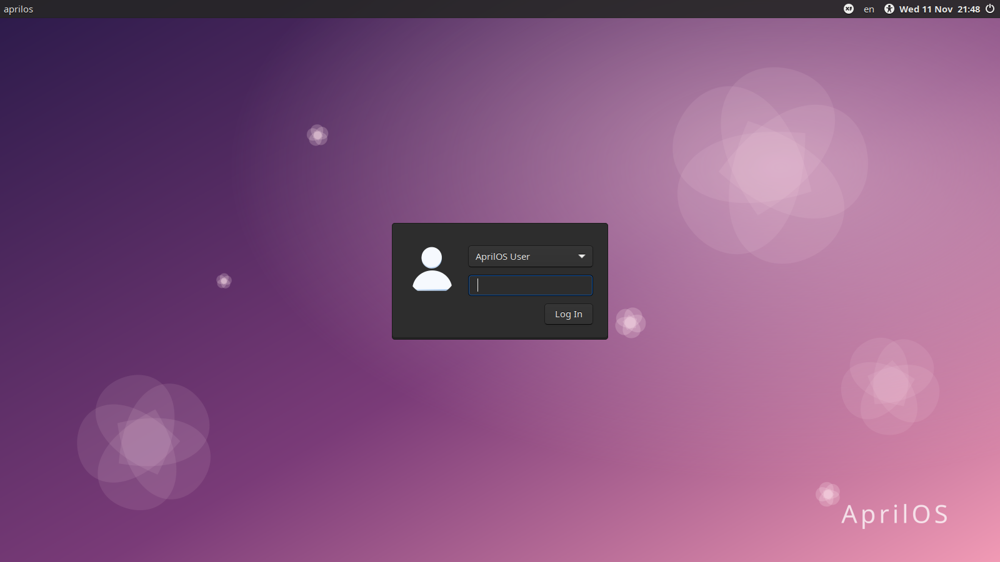
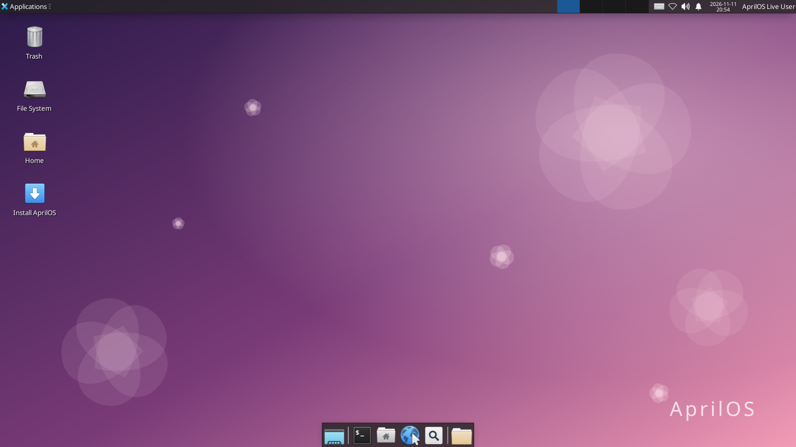

<div align="center">

# AprilOS

**ระบบปฏิบัติการที่เบา สวย และใช้ภาษาไทยได้ตั้งแต่บูตแรก**

สร้างบนฐาน Ubuntu LTS &nbsp;·&nbsp; เดสก์ท็อป XFCE &nbsp;·&nbsp; อัปเดตตัวเองผ่าน GitHub


[ดาวน์โหลด](https://github.com/AImunich20/AprilOS/releases/latest) &nbsp;·&nbsp;
[ติดตั้ง](#ติดตั้ง) &nbsp;·&nbsp;
[Build เอง](#build-เอง) &nbsp;·&nbsp;
[ระบบอัปเดต](#อัปเดตตัวเองผ่าน-github) &nbsp;·&nbsp;
[Roadmap](#roadmap)

<br>



</div>

<table>
<tr>
<td width="50%"></td>
<td width="50%"></td>
</tr>
<tr>
<td align="center"><sub>หน้าจอล็อกอินหลังติดตั้งลงเครื่อง</sub></td>
<td align="center"><sub>Live session จาก USB พร้อมปุ่ม Install AprilOS</sub></td>
</tr>
</table>

---

## จุดเด่น

| | |
|---|---|
| **หน้าตาแบบ macOS** | แถบเมนูด้านบน, Dock ขยายไอคอนเมื่อชี้เมาส์, ปุ่มหน้าต่างอยู่ซ้าย และธีม/ไอคอน/เคอร์เซอร์ WhiteSur |
| **เบาและเร็ว** | ใช้ XFCE เปิดเครื่องไว ใช้ RAM น้อย ทำงานลื่นแม้บนเครื่องรุ่นเก่า |
| **ภาษาไทยพร้อมใช้** | มีฟอนต์ไทย ระบบพิมพ์ไทย (ibus-libthai) และตั้งเขตเวลา Asia/Bangkok ไว้แล้ว |
| **รองรับหลายสถาปัตยกรรม** | มี ISO สำหรับ x86_64 และ ARM64 ใช้ได้ทั้ง PC, เครื่อง ARM และ VM บน Mac Apple Silicon |
| **ติดตั้งง่าย** | ลองใช้จาก USB ได้ทันที แล้วกด "Install AprilOS" เพื่อติดตั้งลงเครื่อง |
| **อัปเดตตัวเอง** | กด Publish release บน GitHub ครั้งเดียว ทุกเครื่องได้อัปเดต พร้อมตรวจ checksum |
| **ฐานแข็งแรง** | Ubuntu LTS รับแพตช์ความปลอดภัยจาก Ubuntu โดยตรง และติดตั้งโปรแกรมจาก `apt` ได้ทั้งหมด |

## หน้าตาแบบ macOS

| ส่วน | ใช้อะไร |
|---|---|
| แถบเมนูด้านบน | xfce4-panel: โลโก้ AprilOS (เปิดเมนูแอป) · ไอคอนหน้าต่างที่ใช้อยู่ · tray · เสียง · แจ้งเตือน · นาฬิกา |
| Dock | Plank กึ่งกลางล่าง ขยายไอคอนเมื่อชี้เมาส์ มีถังขยะ |
| ธีม / ไอคอน / เคอร์เซอร์ | [WhiteSur](https://github.com/vinceliuice/WhiteSur-gtk-theme) Light (หน้าล็อกอินใช้ Dark) |
| ฟอนต์ | Inter (ภาษาไทยใช้ฟอนต์ Noto/TLWG อัตโนมัติ) |
| หน้าต่าง | ปุ่มปิด/ย่อ/ขยายอยู่ซ้าย ชื่ออยู่กลาง มีเงา เปิดกลางจอ |

| ปุ่มลัด | ทำอะไร |
|---|---|
| `Super` + `Space` | ค้นหาแอป (แบบ Spotlight) |
| `Ctrl` + `Space` | สลับภาษาไทย / อังกฤษ |
| `Super` + `Q` / `Super` + `M` | ปิด / ย่อหน้าต่าง |
| `Shift` + `Super` + `3` / `4` | จับภาพทั้งจอ / เลือกพื้นที่ |

ค่าตั้งอยู่ที่ `overlay/etc/skel/.config/` (XFCE) และ `overlay/etc/dconf/db/local.d/` (Dock) ส่วนธีมดาวน์โหลดตอน build โดย
`overlay/usr/local/lib/aprilos/install-macos-look.sh` (ล็อกเวอร์ชันและตรวจ sha256)
เครื่องที่อัปเดตมาจากเวอร์ชันเก่าจะได้ธีมใหม่อัตโนมัติ แต่ต้องรัน `aprilos-apply-macos-look` เพื่อเปลี่ยนแถบเมนูและ Dock ของผู้ใช้เดิม

> AprilOS ไม่ได้ใช้ไฟล์ของ Apple (โลโก้, ฟอนต์ SF, ไอคอน, ภาพพื้นหลัง) เพราะเป็นลิขสิทธิ์ของ Apple — ใช้ของโอเพนซอร์สที่ออกแบบให้คล้ายแทน

## ดาวน์โหลด

เลือกไฟล์ให้ตรงกับเครื่องจากหน้า [Releases](https://github.com/AImunich20/AprilOS/releases/latest)

| ไฟล์ | ใช้กับ |
|---|---|
| `AprilOS-<เวอร์ชัน>-amd64.iso` | PC และโน้ตบุ๊กทั่วไป (Intel / AMD), Mac รุ่น Intel |
| `AprilOS-<เวอร์ชัน>-arm64.iso` | เครื่อง ARM64 ที่บูตแบบ UEFI และ VM บน Mac Apple Silicon |

ตรวจความถูกต้องของไฟล์ได้ด้วย `ISO-SHA256SUMS` ที่แนบมาใน release เดียวกัน

## ติดตั้ง

**บน PC หรือเครื่อง ARM**

1. เขียน ISO ลง USB ด้วย [balenaEtcher](https://etcher.balena.io/) หรือ Rufus
2. บูตจาก USB แล้วเลือก **Try or Install AprilOS** ระบบจะเข้าเดสก์ท็อปทันที
3. ดับเบิลคลิก **Install AprilOS** บนเดสก์ท็อป เลือกดิสก์ ตั้งชื่อผู้ใช้และรหัสผ่าน
4. ติดตั้งเสร็จแล้วถอด USB และรีสตาร์ท

**บน Mac Apple Silicon (M1 / M2 / M3 / M4)**

ใช้ไฟล์ `arm64.iso` กับโปรแกรม VM อย่าง [UTM](https://mac.getutm.app/) (ฟรี), Parallels หรือ VMware Fusion

1. สร้าง VM ใหม่แบบ **Virtualize → Linux** แล้วเลือกไฟล์ ISO
2. แนะนำ RAM 4 GB และดิสก์ 25 GB ขึ้นไป
3. บูตแล้วติดตั้งตามขั้นตอนเดียวกับด้านบน จากนั้นถอด ISO ออกจาก VM

> Mac Apple Silicon บูต Linux ทั่วไปลงเครื่องตรงๆ ไม่ได้ จึงต้องใช้ผ่าน VM ส่วน Mac Intel ใช้ `amd64.iso` บูตจาก USB ได้

**ติดตั้งผ่าน Terminal** (ทั้งแบบถามตอบหรือแบบอัตโนมัติ)

```bash
sudo aprilos-install                                         # แบบถามตอบ
sudo aprilos-install --disk /dev/sda --user april --password '...' --yes
```

> หน้าจอเพี้ยนหรือจอดำ ให้เลือก **(safe graphics)** ที่เมนูบูต
> การติดตั้งจะลบข้อมูลทั้งหมดในดิสก์ที่เลือก

## Build เอง

ต้องมีแค่ **Docker** (Docker Desktop, OrbStack หรือ colima) ใช้ได้ทั้ง macOS และ Linux

```bash
git clone https://github.com/AImunich20/AprilOS.git
cd AprilOS
./build.sh            # build ทั้ง amd64 และ arm64 พร้อมกัน
./build.sh arm64      # หรือเลือกเฉพาะสถาปัตยกรรมเดียว
```

ไฟล์ ISO จะอยู่ใน `out/` พร้อม `ISO-SHA256SUMS` ส่วน log ของแต่ละสถาปัตยกรรมอยู่ใน `out/logs/`

```
debootstrap  ->  ติดตั้งแพ็กเกจ + branding  ->  squashfs (zstd)  ->  ISO (UEFI + BIOS)
```

**เทคนิคที่ทำให้ build เร็ว**

- build ทุกสถาปัตยกรรมพร้อมกัน และบีบอัด squashfs โดยใช้ทุก core ของ CPU
- เก็บแพ็กเกจที่ดาวน์โหลดแล้วไว้ใน Docker volume รอบถัดไปจึงไม่ต้องโหลดใหม่
- ใช้ `eatmydata` ข้ามการ fsync ระหว่างติดตั้งแพ็กเกจ และใช้ zstd แทน xz
- ต้องการไฟล์เล็กที่สุดให้ใช้ `SQUASH_COMP=xz ./build.sh` (ช้ากว่าแต่ไฟล์เล็กลง)

> บน Mac Apple Silicon การ build `arm64` เร็วมากเพราะรันตรงบน CPU ส่วน `amd64` ต้องจำลอง CPU จึงใช้เวลานานกว่า

**ทดสอบใน VM** (ต้องมี `qemu` เช่น `brew install qemu`)

```bash
scripts/test-vm.sh live      # บูต Live ISO แล้วถ่ายภาพหน้าจอ
scripts/test-vm.sh install   # ติดตั้งลงดิสก์เสมือนแบบอัตโนมัติ
scripts/test-vm.sh boot      # บูตเครื่องที่ติดตั้งแล้ว ล็อกอิน และถ่ายภาพหน้าจอ
```

ภาพหน้าจอจะอยู่ใน `out/vm/`

## ปรับแต่ง

| อยากเปลี่ยน | แก้ที่ |
|---|---|
| ชื่อ, เวอร์ชัน, โค้ดเนม, เขตเวลา, ภาษา | `config/aprilos.conf` |
| เพิ่มโปรแกรม | `config/packages.list` |
| ลบโปรแกรมออกจากเครื่องผู้ใช้ตอนอัปเดต | `config/packages-remove.list` |
| Wallpaper | `overlay/usr/share/backgrounds/aprilos/aprilos-default.svg` |
| ไฟล์ตั้งค่าอื่นๆ, ธีม | วางใน `overlay/` ตาม path จริงของระบบ |
| เปลี่ยนเป็น GNOME | แทนส่วน XFCE ใน `packages.list` ด้วย `ubuntu-desktop-minimal` |
| คำสั่งพิเศษตอน build | `scripts/customize-chroot.sh` |

## อัปเดตตัวเองผ่าน GitHub

ทุกเครื่องที่ติดตั้ง AprilOS จะคอยดู **GitHub Releases** ของ repo นี้ เมื่อมีเวอร์ชันใหม่จะแจ้งเตือนหรือติดตั้งให้เอง

```
 ผู้พัฒนา                         GitHub                          เครื่องผู้ใช้
----------                   -------------                   -----------------
push ผ่าน GitHub Desktop --> Release v0.2                     systemd timer (วันละครั้ง)
Publish release              + SHA256SUMS (อัตโนมัติ) <-check-- แจ้งเตือนบนเดสก์ท็อป
                                                     -download-> sudo aprilos-update
```

### ปล่อยเวอร์ชันใหม่

1. แก้ไฟล์ตามต้องการ และเปลี่ยน `OS_VERSION` ใน `config/aprilos.conf` เช่น `"0.2"`
2. Commit และ Push ผ่าน GitHub Desktop
3. Build ISO แล้วสร้าง Draft release พร้อมแนบ ISO ด้วยคำสั่ง

   ```bash
   ./build.sh
   ./scripts/prepare-release.sh "สรุปสิ่งที่เปลี่ยน"
   ```

4. เปิดหน้า [Releases](https://github.com/AImunich20/AprilOS/releases) ตรวจดู แล้วกด **Publish release**

หลังกด Publish, GitHub Actions จะแนบ `SHA256SUMS` ให้อัตโนมัติ และเครื่องผู้ใช้จะเริ่มได้รับอัปเดต
(ข้ามขั้นตอนที่ 3 ได้ ถ้าจะสร้าง release บนหน้าเว็บโดยไม่แนบ ISO ก็ได้เช่นกัน โดยตั้ง tag เป็น `v0.2`)

ติ๊ก **Set as a pre-release** เพื่อปล่อยเป็นเวอร์ชัน beta เช่น tag `v0.3-beta1` จะมีเฉพาะเครื่องที่เปิดรับ beta เท่านั้นที่ได้รับ

### บนเครื่องผู้ใช้

| คำสั่ง | ทำอะไร |
|---|---|
| `aprilos-update status` | ดูเวอร์ชันปัจจุบันและแหล่งอัปเดต |
| `aprilos-update check` | ตรวจว่ามีเวอร์ชันใหม่ไหม |
| `sudo aprilos-update` | ตรวจและติดตั้งอัปเดต |

<details>
<summary><b>ขั้นตอนที่เกิดขึ้นตอนอัปเดต</b></summary>

1. ดาวน์โหลด source ของ tag ล่าสุด แล้วตรวจกับ `SHA256SUMS` ที่แนบใน release
2. `apt full-upgrade` เพื่อรับแพตช์ความปลอดภัยของ Ubuntu
3. ติดตั้งแพ็กเกจที่เพิ่มใหม่ และลบแพ็กเกจตาม `packages-remove.list`
4. คัดลอกไฟล์ใน `overlay/` ลงระบบ (ตัว updater อัปเดตตัวเองในขั้นนี้ด้วย)
5. รันสคริปต์ `updates/migrations/<เวอร์ชัน>.sh` ที่ยังไม่เคยรัน
6. อัปเดตเลขเวอร์ชันใน `/etc/os-release`

log ทั้งหมดอยู่ที่ `/var/log/aprilos-update.log`

</details>

<details>
<summary><b>ตั้งค่า updater</b> (<code>/etc/aprilos/update.conf</code>)</summary>

| ค่า | ความหมาย |
|---|---|
| `AUTO_APPLY="yes"` | ติดตั้งอัปเดตอัตโนมัติ (ค่าเริ่มต้น `no` คือแจ้งเตือนอย่างเดียว) |
| `INCLUDE_PRERELEASE="yes"` | รับเวอร์ชัน beta ด้วย |

</details>

> **ความปลอดภัย:** ใครที่สร้าง release ใน repo นี้ได้ ก็สั่งรันโค้ดด้วยสิทธิ์ root บนเครื่องผู้ใช้ได้ ควรเปิด 2FA และจำกัดคนที่เข้าถึง repo

## โครงสร้างโปรเจกต์

```
AprilOS/
├── build.sh                    build ISO ผ่าน Docker (หลายสถาปัตยกรรมพร้อมกัน)
├── builder/Dockerfile          สภาพแวดล้อมสำหรับ build
├── config/                     ค่าตั้งและรายการแพ็กเกจ
├── scripts/
│   ├── build-iso.sh            debootstrap -> chroot -> squashfs -> ISO
│   ├── customize-chroot.sh     ติดตั้งแพ็กเกจและ branding
│   └── prepare-release.sh      สร้าง Draft release พร้อมแนบ ISO
├── overlay/                    ไฟล์ที่คัดลอกลงระบบ (updater, installer, wallpaper)
├── updates/migrations/         สคริปต์ที่รันครั้งเดียวตอนอัปเดตไปเวอร์ชันนั้น
├── docs/images/                ภาพหน้าจอ
└── .github/workflows/          แนบ checksum ให้ release อัตโนมัติ
```

## Roadmap

- [x] Live ISO บูตได้ทั้ง UEFI และ BIOS
- [x] Branding AprilOS, wallpaper และภาษาไทยพร้อมใช้
- [x] ISO สำหรับ x86_64 และ ARM64 (รวม VM บน Apple Silicon)
- [x] ตัวติดตั้งลงดิสก์ (`aprilos-install`)
- [x] ระบบอัปเดตตัวเองผ่าน GitHub Releases
- [ ] ตัวติดตั้งแบบกราฟิก (Calamares)
- [ ] ธีม ไอคอน และหน้าจอตอนบูต (Plymouth) ของ AprilOS
- [ ] เว็บเบราว์เซอร์ติดตั้งมาให้
- [ ] build ISO อัตโนมัติด้วย GitHub Actions

## ร่วมพัฒนา

ยินดีรับทุก Issue และ Pull Request ไม่ว่าจะเป็นรายงานบั๊ก ไอเดียฟีเจอร์ หรือธีมใหม่

<div align="center">
<br>
<sub>สร้างบนฐาน <a href="https://ubuntu.com">Ubuntu</a> · AprilOS ไม่ได้เกี่ยวข้องหรือได้รับการรับรองจาก Canonical Ltd.</sub>
</div>
